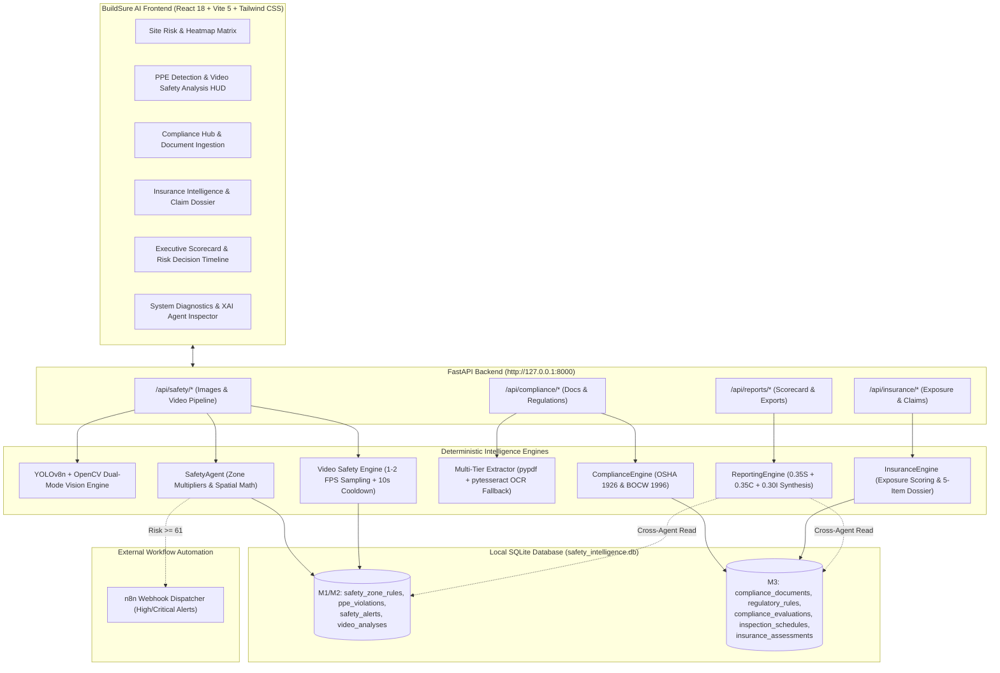

# BuildSure AI — Agentic Construction Risk Intelligence Platform 🏗️🤖

> **Infosys Springboard Internship Project**  
> *Autonomous Multi-Agent AI Ecosystem for Real-Time Safety Monitoring, Worker PPE Intelligence, Site Hazard Detection, Regulatory Compliance, and Construction Insurance Analytics.*

---

## 🚀 Overview & Uniqueness (Why BuildSure AI Stands Out)

Construction sites are high-risk, dynamic environments where traditional manual safety inspections, delayed incident reporting, and fragmented compliance audits fail to prevent catastrophic accidents. 

**BuildSure AI** redefines construction risk management by introducing an **Agentic Multi-AI Ecosystem** that operates as an autonomous risk intelligence layer across construction sites. Instead of static dashboards or basic rule engines, BuildSure AI deploys specialized, collaborating AI Agents that continuously ingest site data, compute multi-factor risk scores, predict hazard escalations, evaluate PPE compliance via YOLO vision, assess multi-jurisdiction regulatory compliance against site documents, and calculate insurance exposure analytics with audit-ready claim dossiers.

### 🌟 Milestone Release Status
- ✅ **Milestone 1**: Site Risk Monitoring & Hazard Detection Core (**Operational**)
- ✅ **Milestone 2**: Functional Hybrid PPE Safety Prototype with YOLOv8n person detection, OpenCV heuristic fallback, SafetyAgent PPE association, SQLite persistence, and n8n webhook automation (**Operational & Frozen**)
- ✅ **Milestone 3**: Compliance & Insurance Intelligence MVP (**Complete & Fully Integrated**)
- ✅ **Milestone 4**: Construction Risk Intelligence, Executive Scorecard, Multi-Format Exports & Offline Video Safety Analysis MVP (**Complete & Fully Operational**)

---

## 👩‍💻 Author & Developer
- **Developer:** Dhanusri S (Reg No: `711524BCS034`)
- **Program:** Infosys Springboard Internship Project 2026
- **Subjects:** Modern Web Programming (MWP) & Deep Neural Networks (DNN)

---

## 🏗️ Multi-Agent Ecosystem Architecture & Data Flow



---

## 🛠️ Key Features by Milestone

### Milestone 1: Site Risk Monitoring Core
1. **Autonomous Site Risk Agent (`SiteRiskAgent.js`)**: Multi-factor risk scoring ($P \times I \times E$ + Weighted formula).
2. **Interactive Spatial Site Map (`SiteMapGrid.jsx`)**: 2D zone risk status, worker count, sensor feeds.
3. **5x5 Risk Heatmap Matrix (`RiskHeatmapMatrix.jsx`)**: Probability vs Impact heatmap matrix.
4. **Live Hazard Detection Panel (`HazardDetectionPanel.jsx`)**: Hazard filtering & XAI decision traces.

### Milestone 2: Safety Intelligence & Worker Protection
1. **Python FastAPI Backend (`/backend`)**: OpenCV visualization, SQLite database via SQLAlchemy.
2. **Ultralytics YOLO Vision Detector (`yolo_detector.py`)**: Detects workers, helmets, vests with confidence scoring.
3. **Autonomous `SafetyAgent` Engine (`safety_agent.py`)**:
   - Head region matching (upper 35% bounding box) for helmets.
   - Torso region matching (middle 40% bounding box) for safety vests.
   - Construction zone rules (General, Excavation, Vehicle, Electrical, Work-at-Height) with risk multipliers ($1.0\times$ to $1.5\times$).
   - Safety risk score formula: $\text{risk\_score} = \min(100, \text{round}(\text{base\_score} \times \text{zone\_multiplier}))$.
   - Low-confidence detections flagged as `needs_human_review`.
4. **Interactive PPE Detection Page (`PPEDetectionPage.jsx`)**: Upload site photos, select work zones, view side-by-side YOLO annotated results.
5. **Safety Intelligence Dashboard (`SafetyDashboardPage.jsx`)**: Live KPI metrics, PPE compliance rates, distribution charts, stored database records.
6. **Safety Alerts & Audit History (`SafetyAlertsPage.jsx`)**: Supervisor alert acknowledge & resolve workflows with audit logs.
7. **n8n Workflow Automation Integration (`n8n_dispatcher.py`)**: Asynchronous, fail-safe webhook notifications for High/Critical risk alerts (`risk_score >= 61`).

### Milestone 3: Compliance & Insurance Intelligence
1. **Multi-Tier Document Ingestion Engine (`document_extractor.py`)**:
   - Native PDF text extraction via `pypdf` (100% local, zero paid cloud APIs).
   - Scanned image / OCR fallback via `pytesseract`.
   - Graceful fallback: If Tesseract OCR is not installed on the system, the application degrades safely to `ocr_unavailable` / `needs_human_review` without crashing.
   - Secure sanitized file naming (`doc_{uuid8}_{timestamp}_{name}`) and 15MB size limit.
2. **Deterministic Regulatory Rule Matcher (`compliance_engine.py`)**:
   - Reference standards across OSHA 1926, Indian BOCW Central Rules 1998, Factories Act 1948, and ISO 45001.
   - Categorizes evidence into 4 explicit statuses: `compliant`, `non_compliant`, `missing_evidence`, and `needs_human_review`.
   - Exact page citation and section header matching (`evidence_page`, `evidence_section`, `evidence_snippet`).
   - Supervisor review gateway with audit overrides.
   - Dynamic inspection & certificate renewal scheduler with `UPCOMING`, `DUE_SOON`, and `OVERDUE` badges.
3. **Insurance Exposure & Claim Adjudication Engine (`insurance_engine.py`)**:
   - Read-only ingestion of SQLite safety records.
   - Calculates site exposure risk score (0–100) and maps to 5 exposure tiers (`NEGLIGIBLE`, `LOW`, `MODERATE`, `HIGH`, `CATASTROPHIC`).
   - Generates 5-item claim dossier checklists (Visual Telemetry, Supervisor Audit Trail, Zone Rule Reference, Worker Induction, Resolution Sign-Off).
   - Supervisor claim adjudication modal with legal policy disclaimers.

### Milestone 4: Risk Intelligence Engine, Video Safety MVP & Multi-Format Exports
1. **Unified Cross-Agent Project Risk Formula (`reporting_engine.py`)**:
   - Deterministic mathematical synthesis combining all 4 agents:
     $$\text{Unified Project Risk Score} = (0.35 \times \text{Safety Score}) + (0.35 \times \text{Compliance Score}) + (0.30 \times \text{Insurance Exposure Score})$$
   - Real-time gauge, status classification (`OPTIMAL`, `CAUTION`, `HIGH_RISK`, `CRITICAL`), and historical trend telemetry.
2. **Offline Video Safety Analysis MVP (`video_safety_service.py` & `VideoSafetyAnalysisPanel.jsx`)**:
   - Extends YOLOv8 PPE detection to uploaded construction video footage (.mp4, .avi, .mov, ≤100MB).
   - Frame sampling at 1–2 FPS for ultra-fast local processing with zero server lag.
   - **10-Second Temporal Cooldown De-duplication**: Groups continuous video frame violations into unified incident cards, eliminating alert storms.
   - **Native Video HUD Player**: Stream switcher (Uploaded Video vs YOLO Keyframe vs AI Stream) with synchronized click-to-seek jump-to-timestamp playback.
3. **Enterprise Multi-Format Export Engine (`/api/reports/export/*`)**:
   - One-click structured JSON data dumps for downstream enterprise systems.
   - Standardized CSV export for tabular spreadsheet compliance reporting.
   - Native Print CSS styling for instant browser Save-to-PDF generation.
4. **Risk Decision Timeline & XAI Inspector (`RiskDecisionTimeline.jsx`)**:
   - Real-time chronological audit trail of all multi-agent actions, supervisor overrides, and safety alerts.
   - Full Settings & Diagnostics page (`SettingsPage.jsx`) displaying AI model parameters, zone multipliers, mathematical registries, and system health.

---

## ⚡ API Endpoints Summary

### Safety & Video Endpoints (`/api/safety/*`)
| Endpoint | Method | Description |
| :--- | :---: | :--- |
| `/health` | `GET` | System health check (DB status, YOLO model status, backend health) |
| `/api/safety/analyze-image` | `POST` | Upload image + zone -> YOLO inference + SafetyAgent evaluation + DB record + n8n dispatch |
| `/api/safety/analyze-video` | `POST` | Upload offline video -> OpenCV 1-2 FPS sampling + 10s cooldown de-duplication + keyframe storage |
| `/api/safety/violations` | `GET` | List stored PPE violations with zone/severity/status filters |
| `/api/safety/summary` | `GET` | Aggregate safety analytics (compliance rates, score, trend) |
| `/api/safety/alerts` | `GET` | List generated safety alerts with evidence URLs & audit logs |
| `/api/safety/alerts/{id}/acknowledge` | `POST` | Acknowledge alert with audit trail entry |
| `/api/safety/alerts/{id}/resolve` | `POST` | Resolve alert with resolution note & audit record |

### Compliance Endpoints (`/api/compliance/*`)
| Endpoint | Method | Description |
| :--- | :---: | :--- |
| `/api/compliance/documents/upload` | `POST` | Upload PDF/image document for text extraction & rule evaluation |
| `/api/compliance/documents` | `GET` | List uploaded compliance documents |
| `/api/compliance/regulations` | `GET` | List regulatory reference standards from knowledge base |
| `/api/compliance/evaluations` | `GET` | List rule evaluations with page citations and evidence snippets |
| `/api/compliance/evaluations/{id}/review` | `POST` | Record supervisor review override on rule evaluation |
| `/api/compliance/schedules` | `GET` / `POST` | List or create inspection/renewal due-date schedules |
| `/api/compliance/report` | `GET` | Export structured JSON compliance audit report |

### Insurance Endpoints (`/api/insurance/*`)
| Endpoint | Method | Description |
| :--- | :---: | :--- |
| `/api/insurance/exposure-summary` | `GET` | Aggregate safety records into exposure score (0-100) & risk tier |
| `/api/insurance/claims` | `GET` | List incident claim assessments with 5-item dossier checklists |
| `/api/insurance/claims/{id}/human-review` | `POST` | Record supervisor adjudication (`APPROVED_FOR_FILING` / `REJECTED`) |

### Milestone 4: Executive Reports & Exports (`/api/reports/*`)
| Endpoint | Method | Description |
| :--- | :---: | :--- |
| `/api/reports/dashboard` | `GET` | Comprehensive executive dashboard data with unified risk score & telemetry |
| `/api/reports/scorecard` | `GET` | Consolidated multi-agent risk scorecard ($0.35S + 0.35C + 0.30I$) |
| `/api/reports/timeline` | `GET` | Chronological multi-agent risk decision audit timeline |
| `/api/reports/export/json` | `GET` | Export complete system intelligence state as structured JSON |
| `/api/reports/export/csv` | `GET` | Export cross-agent safety and compliance records as CSV |

---

## 💻 Quick Start & Running Locally

### 1. Prerequisites
- **Node.js**: v18+ (tested on v20+)
- **Python**: 3.10+ (tested on Python 3.11)
- **Tesseract OCR (Optional)**: For scanned image OCR. If not installed, native PDF extraction operates normally.

### 2. Start Python FastAPI Backend
```powershell
# Navigate to project root
cd infosys-springboard-safety-ai

# (Optional) Seed baseline regulatory rules & schedules
.\venv\Scripts\python.exe backend\seed_compliance_rules.py

# Run FastAPI backend server with auto-reload
.\venv\Scripts\python.exe backend\run_server.py
```
*Backend runs at `http://127.0.0.1:8000`*
- **Health Endpoint**: `http://127.0.0.1:8000/health`
- **Interactive Swagger Docs**: `http://127.0.0.1:8000/docs`

### 3. Start React Frontend
```powershell
# Open a new terminal in project root
cd infosys-springboard-safety-ai

# Start Vite dev server
npm run dev
```
*Frontend runs at `http://localhost:5173`.*

---

## 🔒 Safety, Privacy & Disclaimers
1. **No Face Recognition or PII**: All worker tags use anonymous spatial labels (`Worker-01`, `Worker-02`).
2. **Compliance Disclaimer**: *"Automated AI Assessment — Reference Rule Match — Requires Qualified Safety Supervisor Review. Not a legal or regulatory certification."*
3. **Insurance Decision-Support Disclaimer**: *"Internal safety decision-support estimate only. Does not represent actual insurance policy terms, premiums, or claim settlements."*
4. **Data Privacy**: All processing executes 100% locally with zero external cloud dependencies.

---

## 📚 Technical Documentation & Evaluation Guides
- [Milestone 4 Architecture & Reporting Guide](file:///c:/Users/Dhanusri/Downloads/Infosys/infosys-springboard-safety-ai/docs/MILESTONE_4.md)
- [Video Safety Analysis Engine Specification](file:///c:/Users/Dhanusri/Downloads/Infosys/infosys-springboard-safety-ai/docs/VIDEO_SAFETY_ANALYSIS.md)
- [Milestone Release Status Matrix](file:///c:/Users/Dhanusri/Downloads/Infosys/infosys-springboard-safety-ai/docs/MILESTONE_STATUS.md)
- [Unified Application Architecture Blueprint](file:///c:/Users/Dhanusri/Downloads/Infosys/infosys-springboard-safety-ai/docs/UNIFIED_APPLICATION.md)
- [Milestone 3 Evaluation & Architecture Report](file:///c:/Users/Dhanusri/Downloads/Infosys/infosys-springboard-safety-ai/docs/milestone-3-evaluation.md)
- [Milestone 2 n8n Webhook Integration Guide](file:///c:/Users/Dhanusri/Downloads/Infosys/infosys-springboard-safety-ai/docs/n8n-milestone-2-integration.md)

---

© 2026 BuildSure AI — Dhanusri S. Developed for Infosys Springboard Internship Program.
