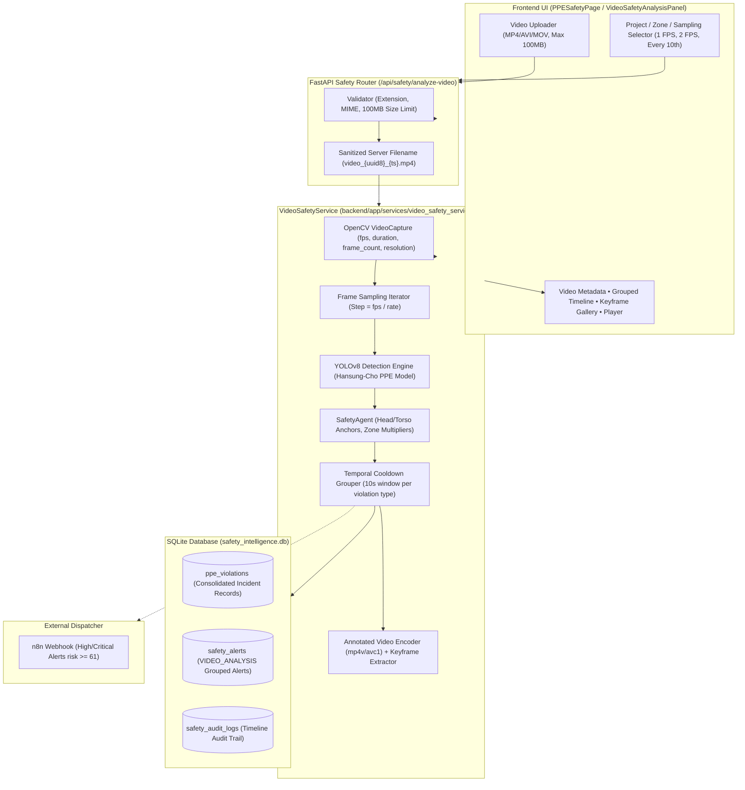
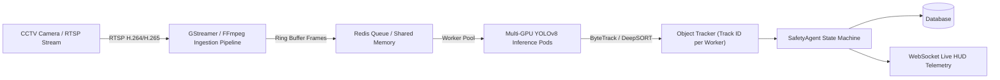

# Video Safety Analysis — Offline Footage Architecture & Specification 📹🏗️

> **BuildSure AI Platform Enhancement**  
> *Deterministic Offline Construction Site Video Safety Processing with Frame Sampling, YOLOv8 PPE Detection, 10s Temporal Cooldown Grouping, and Consolidated Alert Dispatch.*

---

## 1. Objective

The **Offline Video Safety Analysis** module extends BuildSure AI's image-based computer vision workflow to support offline uploaded construction-site video footage. It processes long-form recorded video (.mp4, .avi, .mov), evaluates multi-worker PPE compliance across sampled frames, deterministically groups consecutive frame violations within a 10-second cooldown period, and creates consolidated audit-ready records and alerts for safety supervisors.

---

## 2. Explicit Scope & Limitations

### In-Scope (Delivered MVP)
- ✅ **Offline Uploaded Video Ingestion**: Secure local uploading and validation of video files (.mp4, .avi, .mov) up to 100 MB.
- ✅ **Deterministic Frame Sampling**: Configurable 1 FPS (default), 2 FPS, or modulo-N frame sampling via OpenCV `VideoCapture`.
- ✅ **YOLOv8 PPE Detection & SafetyAgent Spatial Reasoning**: Per-sampled-frame worker bounding boxes, head/torso PPE anchor matching, and OSHA zone risk multipliers ($1.0\times$–$1.5\times$).
- ✅ **10-Second Temporal Cooldown De-duplication**: Consecutive detections of the same violation type in the same project and zone are consolidated into single unified incident periods.
- ✅ **Consolidated SQLite Persistence**: Exactly one violation entry and one safety alert generated per grouped incident (preventing alert flooding).
- ✅ **Non-blocking n8n Automation Webhook**: Dispatched for High and Critical consolidated incidents (`risk_score >= 61`).
- ✅ **Multi-Tier Visual Evidence**: Generates annotated MP4 video output when codecs are available, with safe fallback to keyframe image evidence.
- ✅ **Interactive Frontend Dashboard**: Dual-tab Image vs Video interface with timeline scrubber, keyframe gallery, metadata KPIs, and direct navigation to Safety Alerts and Executive Reports.

### Explicit Out-of-Scope Limitations
- ❌ **NOT Live CCTV Monitoring**: The system does not connect to continuous live feeds.
- ❌ **NOT RTSP / WebRTC / RTMP Streaming**: No live stream ingest or low-latency stream transcoding.
- ❌ **NOT Multi-Camera Grid Surveillance**: Processes individual uploaded footage files sequentially.
- ❌ **NO Biometric or Facial Recognition**: Workers are assigned anonymous spatial identifiers (`Worker-01`, `Incident-INC-V001`).
- ❌ **NO Persistent Worker Re-Identification Across Cameras**: Groups detections by temporal proximity and zone, not persistent biometric identity.

---

## 3. Architecture & Data Flow

---

## 4. Supported Formats, Size Limits & Security

| Parameter | Specification | Validation Enforcement |
| :--- | :--- | :--- |
| **Allowed File Formats** | `.mp4`, `.avi`, `.mov` | Server-side extension check + MIME inspection |
| **Max File Size** | 100 MB (Configurable via `MAX_VIDEO_SIZE_MB`) | Strict byte-count check before processing |
| **Storage Location** | `backend/uploads/` | Server-generated sanitized name `video_{uuid8}_{timestamp}.ext` |
| **Output Location** | `backend/results/` | `annotated_{uuid8}_{timestamp}.mp4` & `keyframe_{uuid8}_f{N}.jpg` |
| **Temporary Cleanup** | `temp_{uuid8}_f{N}.jpg` | Automatically cleaned from disk in `finally` block |

---

## 5. Sampling & De-Duplication Logic

### Sampling Strategy
- **1 FPS (Default)**: Samples 1 frame every second (`step = max(1, round(fps))`). Ideal for standard site audits with minimal CPU overhead.
- **2 FPS**: Samples 2 frames per second (`step = max(1, round(fps / 2))`). Ideal for high-movement zones.
- **Every 10th Frame**: Traverses frame indices modulo 10.

### 10-Second Temporal Cooldown Grouping
To prevent creating hundreds of duplicate database violations for a single worker walking across frames without a helmet:
1. Detections are mapped by a composite key: `(project_id, zone_name, violation_type)`.
2. When a violation appears on frame $T$, the service checks if an active incident group exists within `current_time - end_time <= 10.0s`.
3. If active within 10s:
   - Extends the existing incident (`end_timestamp = current_time`, `end_frame = frame_idx`).
   - Increments `occurrences_count`.
   - Updates `peak_risk_score = max(peak_risk_score, current_risk)`.
   - Retains highest-risk keyframe as visual evidence.
4. If time gap exceeds 10s:
   - Finalizes the previous incident group and stores it to SQLite.
   - Initializes a new incident group.

---

## 6. Alert Aggregation & n8n Integration

- **Alert Consolidation**: Rather than triggering an alert on every video frame, exactly **one consolidated alert** is created per grouped incident.
- **Source Attribution**: All alerts generated from video are explicitly prefixed with `VIDEO_ANALYSIS` and logged with user reference `VideoSafetyAgent-System`.
- **Threshold Rule**: Only incidents with `peak_risk_score >= 61.0` or severity `HIGH`/`CRITICAL` trigger n8n external webhook dispatch.
- **Non-blocking Execution**: n8n dispatch errors are caught and logged without failing the video analysis pipeline.

---

## 7. Future CCTV / RTSP Integration Architecture

For transition to real-time CCTV / RTSP monitoring in future production phases:

### Key Engineering Steps for Live RTSP:
1. **RTSP Stream Ingestion**: Implement FFmpeg/GStreamer pipeline with hardware-accelerated decoding (NVDEC/VAAPI).
2. **Object Tracking**: Integrate ByteTrack / DeepSORT for persistent bounding box IDs across occlusions.
3. **Sliding Window State Machine**: Maintain violation states per `TrackID` with entry/exit debounce counters.
4. **WebSocket Push**: Broadcast live overlay coordinates to the React frontend over WebSockets.

---

## 8. Privacy & Advisory Disclaimers

> ⚠️ **PERMANENT DISCLAIMER**:  
> *Offline video safety analysis is an automated AI decision-support tool. It is NOT live CCTV surveillance or an automated disciplinary system. Detections and risk scores are advisory and require qualified site safety supervisor verification. No biometric facial recognition or persistent personal identification is performed.*

---

## 9. Verification & Test Results

The video safety analysis suite was verified locally on Windows with Python 3.11 and PyTorch:

| Test Case | Description | Result |
| :--- | :--- | :---: |
| `test_01_health_check` | Health check endpoint verification | ✅ PASS |
| `test_02_unsupported_file_extension` | Non-video file (.txt) rejected with HTTP 400 | ✅ PASS |
| `test_03_oversized_file_validation` | File size > 100MB rejected | ✅ PASS |
| `test_04_small_valid_mp4_no_violations` | Valid MP4 with no violations returns 0 incidents and null score | ✅ PASS |
| `test_05_corrupt_video_handling` | Corrupt binary video returns descriptive HTTP 400 | ✅ PASS |
| `test_06_temporal_grouping_logic` | 10s cooldown groups 5 frames into 2 incidents correctly | ✅ PASS |
| `test_07_existing_image_analysis_unaltered` | Existing `/api/safety/analyze-image` remains 100% functional | ✅ PASS |
| `npm run build` | Frontend Vite production build test | ✅ PASS (0 errors) |
